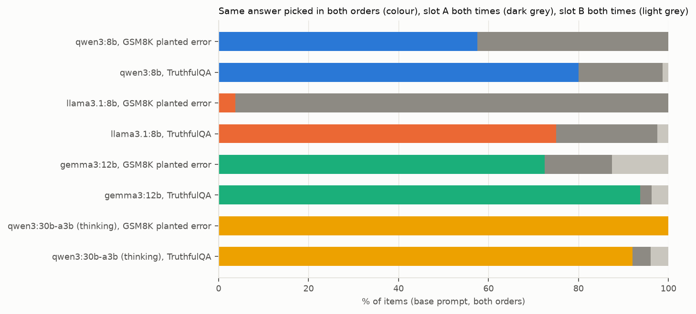
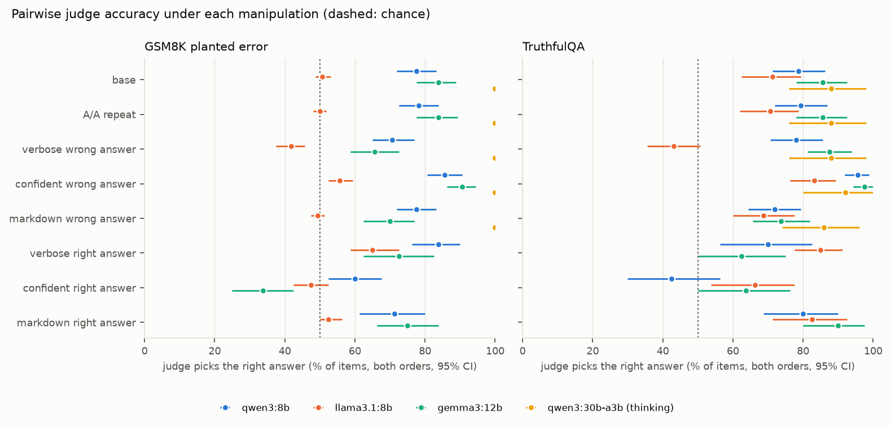
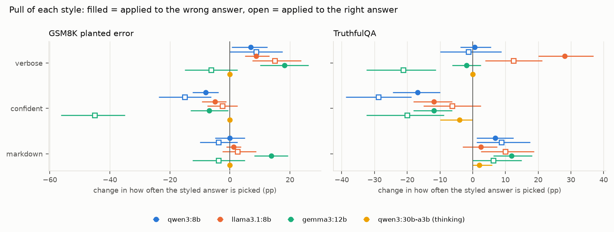
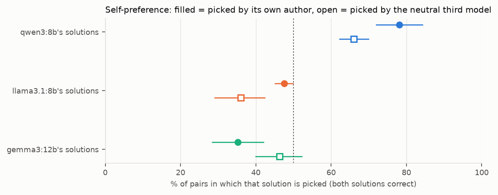

# Results

Generated by `uv run judgebias report` from `results/rows/*.jsonl` and `data/items.jsonl`. Every number below is computed by code from cached model outputs, re-parsed with the current parser. Intervals are 95% percentile bootstraps (2,000 resamples) over items (both orders of an item, and all its conditions, move together), stratified by task when tasks are pooled. `pp` = percentage points; `*` marks a difference whose interval excludes zero.

## Headline

- **qwen3:8b** (160 items, both tasks): picks the right answer in 78.1% [73.4, 82.5] of item-orders; same pick in both orders on 68.8% [61.9, 75.6] of items, slot A both times on 30.6% [23.8, 37.5], slot B both times on 0.6% [0.0, 1.9]. A/A repeat changed 0.6% [0.0, 1.6] of verdicts.
- **llama3.1:8b** (160 items, both tasks): picks the right answer in 60.9% [56.6, 65.0] of item-orders; same pick in both orders on 39.4% [34.4, 44.4] of items, slot A both times on 59.4% [54.4, 64.4], slot B both times on 1.2% [0.0, 3.1]. A/A repeat changed 0.6% [0.0, 1.6] of verdicts.
- **gemma3:12b** (160 items, both tasks): picks the right answer in 84.7% [80.0, 89.4] of item-orders; same pick in both orders on 83.1% [77.5, 88.8] of items, slot A both times on 8.8% [5.0, 13.1], slot B both times on 8.1% [4.4, 12.5]. A/A repeat changed 0.6% [0.0, 1.6] of verdicts.
- **qwen3:30b-a3b (thinking)** (50 items, both tasks): picks the right answer in 94.0% [88.0, 99.0] of item-orders; same pick in both orders on 96.0% [90.0, 100.0] of items, slot A both times on 2.0% [0.0, 6.0], slot B both times on 2.0% [0.0, 6.0]. A/A repeat changed 0.0% [0.0, 0.0] of verdicts.

- **qwen3:8b**, accuracy change when the wrong answer is restyled: verbose wrong answer -3.8 pp [-7.5, +0.0]; confident wrong answer +12.5 pp [+8.8, +16.6] *; markdown wrong answer -3.4 pp [-7.2, +0.0].
- **llama3.1:8b**, accuracy change when the wrong answer is restyled: verbose wrong answer -18.4 pp [-23.4, -13.8] *; confident wrong answer +8.4 pp [+4.7, +11.9] *; markdown wrong answer -1.9 pp [-4.7, +0.9].
- **gemma3:12b**, accuracy change when the wrong answer is restyled: verbose wrong answer -8.1 pp [-12.8, -3.4] *; confident wrong answer +9.4 pp [+5.0, +14.1] *; markdown wrong answer -12.8 pp [-16.9, -8.8] *.
- **qwen3:30b-a3b (thinking)**, accuracy change when the wrong answer is restyled: verbose wrong answer +0.0 pp [+0.0, +0.0]; confident wrong answer +2.0 pp [+0.0, +5.0]; markdown wrong answer -1.0 pp [-3.0, +0.0].

## 1. Setup

| model | digest | mode | calls | median server s/call | mean output tokens | hit length cap | parsed | parse rule |
|---|---|---|---|---|---|---|---|---|
| qwen3:8b | 500a1f067a9f | pair | 2228 | 4.8 | 73 | 0.0% | 100.0% | cue 100% |
| qwen3:8b | 500a1f067a9f | self | 336 | 5.9 | 78 | 0.0% | 100.0% | cue 100% |
| qwen3:8b | 500a1f067a9f | point | 560 | 5.1 | 77 | 0.0% | 100.0% | cue 100% |
| qwen3:8b | 500a1f067a9f | gen | 60 | 16.0 | 263 | 0.0% | 100.0% | cue 57%, boxed 43% |
| llama3.1:8b | 46e0c10c039e | pair | 2228 | 5.1 | 83 | 0.9% | 100.0% | cue 99%, is better 1% |
| llama3.1:8b | 46e0c10c039e | self | 336 | 5.5 | 80 | 0.0% | 100.0% | cue 100% |
| llama3.1:8b | 46e0c10c039e | point | 560 | 5.4 | 90 | 0.0% | 98.9% | cue 99%, none 1%, inline score 0% |
| llama3.1:8b | 46e0c10c039e | gen | 60 | 12.2 | 227 | 1.7% | 100.0% | cue 97%, last number 3% |
| gemma3:12b | b92b218582c5 | pair | 2228 | 8.1 | 91 | 0.0% | 100.0% | cue 100%, none 0% |
| gemma3:12b | b92b218582c5 | self | 336 | 8.0 | 90 | 0.0% | 100.0% | cue 100% |
| gemma3:12b | b92b218582c5 | point | 560 | 3.3 | 86 | 0.0% | 100.0% | cue 100% |
| gemma3:12b | b92b218582c5 | gen | 60 | 17.5 | 208 | 1.7% | 100.0% | cue 98%, last number 2% |
| qwen3:30b-a3b (thinking) | ad815644918f | pair | 500 | 6.1 | 489 | 0.0% | 100.0% | cue 100% |

Items in this split: 100 GSM8K planted-error pairs, 100 TruthfulQA pairs, 100 GSM8K problems for self-preference, 74 MT-bench pairs. Each table uses the items on which every condition it compares was answered in both orders.

## 2. Accuracy and position bias (base prompt)

Accuracy = share of (item, order) calls in which the judge picks the right answer; an unparsed verdict counts as wrong. Consistent = the same answer picked in both orders. `RW` = right answer in slot A, `WR` = right answer in slot B.



| judge | task | items | accuracy | consistent | slot A both | slot B both | P(verdict A) | accuracy RW | accuracy WR | RW minus WR |
|---|---|---|---|---|---|---|---|---|---|---|
| qwen3:8b | GSM8K planted error | 80 | 77.5% [71.9, 83.1] | 57.5% [46.2, 68.8] | 42.5% [31.2, 53.8] | 0.0% [0.0, 0.0] | 71.2% [65.6, 76.9] | 98.8% [96.2, 100.0] | 56.2% [45.0, 67.5] | +42.5 pp [+31.2, +53.8] * |
| qwen3:8b | TruthfulQA | 80 | 78.8% [71.2, 86.2] | 80.0% [71.2, 88.8] | 18.8% [11.2, 27.5] | 1.2% [0.0, 3.8] | 58.8% [54.4, 63.1] | 87.5% [80.0, 93.8] | 70.0% [60.0, 80.0] | +17.5 pp [+8.8, +26.2] * |
| qwen3:8b | both tasks | 160 | 78.1% [73.4, 82.5] | 68.8% [61.9, 75.6] | 30.6% [23.8, 37.5] | 0.6% [0.0, 1.9] | 65.0% [61.6, 68.4] | 93.1% [89.4, 96.9] | 63.1% [55.6, 70.6] | +30.0 pp [+23.1, +36.9] * |
| llama3.1:8b | GSM8K planted error | 80 | 50.6% [48.8, 53.1] | 3.8% [0.0, 8.8] | 96.2% [91.2, 100.0] | 0.0% [0.0, 0.0] | 98.1% [95.6, 100.0] | 98.8% [96.2, 100.0] | 2.5% [0.0, 6.2] | +96.2 pp [+91.2, +100.0] * |
| llama3.1:8b | TruthfulQA | 80 | 71.2% [62.5, 79.4] | 75.0% [66.2, 85.0] | 22.5% [13.8, 32.5] | 2.5% [0.0, 6.2] | 60.0% [55.0, 65.0] | 81.2% [72.5, 90.0] | 61.3% [50.0, 71.2] | +20.0 pp [+10.0, +30.0] * |
| llama3.1:8b | both tasks | 160 | 60.9% [56.6, 65.0] | 39.4% [34.4, 44.4] | 59.4% [54.4, 64.4] | 1.2% [0.0, 3.1] | 79.1% [76.6, 81.6] | 90.0% [85.0, 94.4] | 31.9% [26.9, 37.5] | +58.1 pp [+53.1, +63.1] * |
| gemma3:12b | GSM8K planted error | 80 | 83.8% [77.5, 88.8] | 72.5% [62.5, 82.5] | 15.0% [7.5, 23.8] | 12.5% [6.2, 20.0] | 51.2% [45.6, 56.9] | 85.0% [76.2, 92.5] | 82.5% [73.8, 90.0] | +2.5 pp [-8.8, +13.8] |
| gemma3:12b | TruthfulQA | 80 | 85.6% [78.1, 92.5] | 93.8% [88.8, 98.8] | 2.5% [0.0, 6.2] | 3.8% [0.0, 8.8] | 49.4% [46.9, 51.9] | 85.0% [77.5, 92.5] | 86.2% [78.8, 93.8] | -1.2 pp [-6.2, +3.8] |
| gemma3:12b | both tasks | 160 | 84.7% [80.0, 89.4] | 83.1% [77.5, 88.8] | 8.8% [5.0, 13.1] | 8.1% [4.4, 12.5] | 50.3% [47.2, 53.4] | 85.0% [79.4, 90.6] | 84.4% [78.8, 90.0] | +0.6 pp [-5.6, +6.9] |
| qwen3:30b-a3b (thinking) | GSM8K planted error | 25 | 100.0% [100.0, 100.0] | 100.0% [100.0, 100.0] | 0.0% [0.0, 0.0] | 0.0% [0.0, 0.0] | 50.0% [50.0, 50.0] | 100.0% [100.0, 100.0] | 100.0% [100.0, 100.0] | +0.0 pp [+0.0, +0.0] |
| qwen3:30b-a3b (thinking) | TruthfulQA | 25 | 88.0% [76.0, 98.0] | 92.0% [80.0, 100.0] | 4.0% [0.0, 12.0] | 4.0% [0.0, 12.0] | 50.0% [44.0, 56.0] | 88.0% [76.0, 100.0] | 88.0% [76.0, 100.0] | +0.0 pp [-12.0, +12.0] |
| qwen3:30b-a3b (thinking) | both tasks | 50 | 94.0% [88.0, 99.0] | 96.0% [90.0, 100.0] | 2.0% [0.0, 6.0] | 2.0% [0.0, 6.0] | 50.0% [47.0, 53.0] | 94.0% [88.0, 100.0] | 94.0% [86.0, 100.0] | +0.0 pp [-6.0, +6.0] |

GSM8K base accuracy by where the planted error is (exploratory):

| judge | error in the last calculation | items | error earlier | items |
|---|---|---|---|---|
| qwen3:8b | 76.2% [68.8, 83.8] | 40 | 78.8% [70.0, 86.2] | 40 |
| llama3.1:8b | 51.2% [50.0, 53.8] | 40 | 50.0% [46.2, 53.8] | 40 |
| gemma3:12b | 87.5% [80.0, 93.8] | 40 | 80.0% [70.0, 88.8] | 40 |
| qwen3:30b-a3b (thinking) | 100.0% [100.0, 100.0] | 13 | 100.0% [100.0, 100.0] | 12 |

## 3. Noise floor: the identical prompt sent twice

Each base prompt is sent a second time as a separate call with its own cache entry, in both orders, spread through the run. A manipulation only counts as moving verdicts when its flip rate minus this repeat's has an interval above zero (paired by item).

| judge | task | items | verdicts changed (of 2 per item) | flip rate | accuracy change |
|---|---|---|---|---|---|
| qwen3:8b | GSM8K planted error | 80 | 1 | 0.6% [0.0, 1.9] | +0.6 pp [+0.0, +1.9] |
| qwen3:8b | TruthfulQA | 80 | 1 | 0.6% [0.0, 1.9] | +0.6 pp [+0.0, +1.9] |
| qwen3:8b | both tasks | 160 | 2 | 0.6% [0.0, 1.6] | +0.6 pp [+0.0, +1.6] |
| llama3.1:8b | GSM8K planted error | 80 | 1 | 0.6% [0.0, 1.9] | -0.6 pp [-1.9, +0.0] |
| llama3.1:8b | TruthfulQA | 80 | 1 | 0.6% [0.0, 1.9] | -0.6 pp [-1.9, +0.0] |
| llama3.1:8b | both tasks | 160 | 2 | 0.6% [0.0, 1.6] | -0.6 pp [-1.6, +0.0] |
| gemma3:12b | GSM8K planted error | 80 | 2 | 1.2% [0.0, 3.1] | +0.0 pp [-1.9, +1.9] |
| gemma3:12b | TruthfulQA | 80 | 0 | 0.0% [0.0, 0.0] | +0.0 pp [+0.0, +0.0] |
| gemma3:12b | both tasks | 160 | 2 | 0.6% [0.0, 1.6] | +0.0 pp [-0.9, +0.9] |
| qwen3:30b-a3b (thinking) | GSM8K planted error | 25 | 0 | 0.0% [0.0, 0.0] | +0.0 pp [+0.0, +0.0] |
| qwen3:30b-a3b (thinking) | TruthfulQA | 25 | 0 | 0.0% [0.0, 0.0] | +0.0 pp [+0.0, +0.0] |
| qwen3:30b-a3b (thinking) | both tasks | 50 | 0 | 0.0% [0.0, 0.0] | +0.0 pp [+0.0, +0.0] |

## 4. Manipulations

One answer is restyled at a time, in both orders. Flip rate = share of item-orders whose pick differs from the base prompt's. Excess = flip rate minus the A/A repeat's on the same items. Accuracy change is paired by item against the base prompt.



**qwen3:8b, GSM8K planted error** (base accuracy 77.5% [71.9, 83.1])

| condition | items | accuracy | change vs base | flip rate | excess over A/A | consistent |
|---|---|---|---|---|---|---|
| A/A repeat | 80 | 78.1% [72.5, 83.8] | +0.6 pp [+0.0, +1.9] | 0.6% [0.0, 1.9] |  | 58.8% [47.5, 70.0] |
| verbose wrong answer | 80 | 70.6% [65.0, 76.9] | -6.9 pp [-12.5, -0.6] * | 15.6% [10.0, 21.2] | +15.0 pp [+9.4, +20.6] * | 46.2% [35.0, 57.5] |
| confident wrong answer | 80 | 85.6% [80.6, 90.6] | +8.1 pp [+3.8, +12.5] * | 9.4% [5.6, 13.8] | +8.8 pp [+5.0, +13.1] * | 71.2% [61.3, 81.2] |
| markdown wrong answer | 80 | 77.5% [71.9, 83.1] | +0.0 pp [-5.0, +5.0] | 10.0% [5.6, 15.0] | +9.4 pp [+5.0, +14.4] * | 57.5% [46.2, 68.8] |
| verbose right answer | 40 | 83.8% [76.2, 90.0] | +8.8 pp [+0.0, +17.5] | 16.2% [8.8, 25.0] | +15.0 pp [+7.5, +23.8] * | 67.5% [52.5, 80.0] |
| confident right answer | 40 | 60.0% [52.5, 67.5] | -15.0 pp [-23.8, -6.2] * | 20.0% [12.5, 27.5] | +18.8 pp [+10.0, +27.5] * | 25.0% [12.5, 37.6] |
| markdown right answer | 40 | 71.2% [61.3, 80.0] | -3.8 pp [-10.0, +2.5] | 8.8% [3.8, 15.0] | +7.5 pp [+2.5, +13.8] * | 52.5% [37.5, 67.5] |

**qwen3:8b, TruthfulQA** (base accuracy 78.8% [71.2, 86.2])

| condition | items | accuracy | change vs base | flip rate | excess over A/A | consistent |
|---|---|---|---|---|---|---|
| A/A repeat | 80 | 79.4% [71.9, 86.9] | +0.6 pp [+0.0, +1.9] | 0.6% [0.0, 1.9] |  | 81.2% [72.5, 88.8] |
| verbose wrong answer | 80 | 78.1% [70.6, 85.6] | -0.6 pp [-5.6, +3.8] | 10.6% [5.6, 16.2] | +10.0 pp [+5.0, +15.6] * | 78.8% [70.0, 87.5] |
| confident wrong answer | 80 | 95.6% [91.9, 98.8] | +16.9 pp [+10.0, +24.4] * | 16.9% [10.0, 24.4] | +16.2 pp [+9.4, +23.1] * | 93.8% [87.5, 98.8] |
| markdown wrong answer | 80 | 71.9% [64.4, 79.4] | -6.9 pp [-12.5, -1.2] * | 11.9% [6.9, 16.9] | +11.2 pp [+6.2, +16.9] * | 68.8% [58.8, 78.8] |
| verbose right answer | 40 | 70.0% [56.2, 82.5] | -1.2 pp [-10.0, +8.8] | 13.8% [6.2, 22.5] | +12.5 pp [+5.0, +21.2] * | 90.0% [80.0, 97.5] |
| confident right answer | 40 | 42.5% [30.0, 56.2] | -28.7 pp [-38.8, -18.8] * | 31.2% [21.2, 41.2] | +30.0 pp [+20.0, +40.0] * | 70.0% [55.0, 82.5] |
| markdown right answer | 40 | 80.0% [68.8, 90.0] | +8.8 pp [+1.2, +17.5] * | 11.2% [3.8, 20.0] | +10.0 pp [+2.5, +18.8] * | 80.0% [67.5, 92.5] |

**qwen3:8b, both tasks** (base accuracy 78.1% [73.4, 82.5])

| condition | items | accuracy | change vs base | flip rate | excess over A/A | consistent |
|---|---|---|---|---|---|---|
| A/A repeat | 160 | 78.8% [74.1, 83.4] | +0.6 pp [+0.0, +1.6] | 0.6% [0.0, 1.6] |  | 70.0% [63.1, 76.9] |
| verbose wrong answer | 160 | 74.4% [69.7, 79.1] | -3.8 pp [-7.5, +0.0] | 13.1% [9.4, 16.9] | +12.5 pp [+8.8, +16.6] * | 62.5% [55.6, 70.0] |
| confident wrong answer | 160 | 90.6% [87.5, 93.4] | +12.5 pp [+8.8, +16.6] * | 13.1% [9.1, 17.2] | +12.5 pp [+8.8, +16.6] * | 82.5% [76.9, 88.1] |
| markdown wrong answer | 160 | 74.7% [69.7, 79.4] | -3.4 pp [-7.2, +0.0] | 10.9% [7.5, 14.4] | +10.3 pp [+6.9, +14.1] * | 63.1% [55.6, 70.0] |
| verbose right answer | 80 | 76.9% [69.4, 84.4] | +3.8 pp [-1.9, +10.0] | 15.0% [9.4, 20.6] | +13.8 pp [+8.8, +19.4] * | 78.8% [70.0, 86.3] |
| confident right answer | 80 | 51.2% [43.8, 58.1] | -21.9 pp [-28.7, -15.6] * | 25.6% [20.0, 31.9] | +24.4 pp [+18.1, +31.2] * | 47.5% [37.5, 56.2] |
| markdown right answer | 80 | 75.6% [69.4, 82.5] | +2.5 pp [-2.5, +8.1] | 10.0% [5.6, 15.0] | +8.8 pp [+4.4, +13.8] * | 66.2% [56.2, 76.2] |

**llama3.1:8b, GSM8K planted error** (base accuracy 50.6% [48.8, 53.1])

| condition | items | accuracy | change vs base | flip rate | excess over A/A | consistent |
|---|---|---|---|---|---|---|
| A/A repeat | 80 | 50.0% [48.1, 51.9] | -0.6 pp [-1.9, +0.0] | 0.6% [0.0, 1.9] |  | 2.5% [0.0, 6.2] |
| verbose wrong answer | 80 | 41.9% [37.5, 45.6] | -8.8 pp [-13.1, -5.0] * | 8.8% [5.0, 13.1] | +8.1 pp [+4.4, +12.5] * | 16.2% [8.8, 25.0] |
| confident wrong answer | 80 | 55.6% [52.5, 59.4] | +5.0 pp [+1.2, +9.4] * | 6.2% [2.5, 10.6] | +5.6 pp [+1.9, +10.0] * | 11.2% [5.0, 18.8] |
| markdown wrong answer | 80 | 49.4% [47.5, 51.2] | -1.2 pp [-3.8, +1.2] | 2.5% [0.6, 5.0] | +1.9 pp [+0.0, +4.4] | 3.8% [0.0, 8.8] |
| verbose right answer | 40 | 65.0% [58.8, 72.5] | +15.0 pp [+7.5, +23.8] * | 15.0% [7.5, 23.8] | +15.0 pp [+7.5, +23.8] * | 30.0% [17.5, 45.0] |
| confident right answer | 40 | 47.5% [42.5, 52.5] | -2.5 pp [-7.5, +2.5] | 5.0% [1.2, 10.0] | +5.0 pp [+1.2, +10.0] * | 10.0% [2.5, 20.0] |
| markdown right answer | 40 | 52.5% [50.0, 56.2] | +2.5 pp [-2.5, +8.8] | 5.0% [0.0, 11.2] | +5.0 pp [+0.0, +11.2] | 5.0% [0.0, 12.5] |

**llama3.1:8b, TruthfulQA** (base accuracy 71.2% [62.5, 79.4])

| condition | items | accuracy | change vs base | flip rate | excess over A/A | consistent |
|---|---|---|---|---|---|---|
| A/A repeat | 80 | 70.6% [61.9, 78.8] | -0.6 pp [-1.9, +0.0] | 0.6% [0.0, 1.9] |  | 76.2% [67.5, 85.0] |
| verbose wrong answer | 80 | 43.1% [35.6, 50.6] | -28.1 pp [-36.9, -20.0] * | 33.1% [25.0, 40.6] | +32.5 pp [+25.0, +40.6] * | 53.8% [42.5, 65.0] |
| confident wrong answer | 80 | 83.1% [76.2, 89.4] | +11.9 pp [+6.2, +18.1] * | 18.1% [11.9, 24.4] | +17.5 pp [+11.9, +23.8] * | 81.2% [72.5, 90.0] |
| markdown wrong answer | 80 | 68.8% [60.0, 77.5] | -2.5 pp [-7.5, +3.1] | 11.2% [6.2, 16.9] | +10.6 pp [+5.6, +15.6] * | 72.5% [62.5, 82.5] |
| verbose right answer | 40 | 85.0% [77.5, 91.2] | +12.5 pp [+3.8, +21.2] * | 20.0% [11.2, 30.0] | +18.8 pp [+11.2, +27.5] * | 70.0% [55.0, 82.5] |
| confident right answer | 40 | 66.2% [53.8, 77.5] | -6.2 pp [-15.0, +2.5] | 16.2% [8.8, 23.8] | +15.0 pp [+6.2, +22.5] * | 67.5% [52.5, 82.5] |
| markdown right answer | 40 | 82.5% [71.2, 92.5] | +10.0 pp [+2.5, +18.8] * | 17.5% [8.8, 26.2] | +16.2 pp [+8.7, +25.0] * | 85.0% [72.5, 95.0] |

**llama3.1:8b, both tasks** (base accuracy 60.9% [56.6, 65.0])

| condition | items | accuracy | change vs base | flip rate | excess over A/A | consistent |
|---|---|---|---|---|---|---|
| A/A repeat | 160 | 60.3% [55.6, 64.7] | -0.6 pp [-1.6, +0.0] | 0.6% [0.0, 1.6] |  | 39.4% [34.4, 44.4] |
| verbose wrong answer | 160 | 42.5% [38.1, 46.9] | -18.4 pp [-23.4, -13.8] * | 20.9% [16.9, 25.3] | +20.3 pp [+16.2, +24.7] * | 35.0% [28.1, 41.9] |
| confident wrong answer | 160 | 69.4% [65.6, 72.8] | +8.4 pp [+4.7, +11.9] * | 12.2% [8.4, 15.9] | +11.6 pp [+8.1, +15.3] * | 46.2% [40.6, 51.9] |
| markdown wrong answer | 160 | 59.1% [54.7, 63.4] | -1.9 pp [-4.7, +0.9] | 6.9% [4.4, 10.0] | +6.2 pp [+3.8, +9.1] * | 38.1% [32.5, 43.1] |
| verbose right answer | 80 | 75.0% [70.0, 80.0] | +13.8 pp [+8.1, +20.0] * | 17.5% [11.9, 23.8] | +16.9 pp [+11.9, +23.1] * | 50.0% [40.0, 60.0] |
| confident right answer | 80 | 56.9% [50.6, 62.5] | -4.4 pp [-9.4, +0.6] | 10.6% [6.2, 15.0] | +10.0 pp [+5.6, +15.0] * | 38.8% [30.0, 47.5] |
| markdown right answer | 80 | 67.5% [61.9, 72.5] | +6.2 pp [+1.2, +11.9] * | 11.2% [6.2, 16.9] | +10.6 pp [+5.6, +16.2] * | 45.0% [38.8, 51.2] |

**gemma3:12b, GSM8K planted error** (base accuracy 83.8% [77.5, 88.8])

| condition | items | accuracy | change vs base | flip rate | excess over A/A | consistent |
|---|---|---|---|---|---|---|
| A/A repeat | 80 | 83.8% [77.5, 89.4] | +0.0 pp [-1.9, +1.9] | 1.2% [0.0, 3.1] |  | 72.5% [62.5, 82.5] |
| verbose wrong answer | 80 | 65.6% [58.8, 72.5] | -18.1 pp [-26.2, -10.0] * | 25.6% [18.8, 33.1] | +24.4 pp [+17.5, +31.9] * | 50.0% [38.8, 60.0] |
| confident wrong answer | 80 | 90.6% [86.2, 94.4] | +6.9 pp [+0.6, +13.1] * | 16.9% [11.2, 23.8] | +15.6 pp [+10.0, +22.5] * | 81.2% [72.5, 88.8] |
| markdown wrong answer | 80 | 70.0% [62.5, 76.9] | -13.8 pp [-19.4, -8.1] * | 17.5% [11.9, 23.8] | +16.2 pp [+10.6, +22.5] * | 57.5% [47.5, 68.8] |
| verbose right answer | 40 | 72.5% [62.5, 82.5] | -6.2 pp [-15.0, +2.5] | 21.2% [13.8, 30.0] | +20.0 pp [+12.5, +28.7] * | 65.0% [50.0, 80.0] |
| confident right answer | 40 | 33.8% [25.0, 42.5] | -45.0 pp [-56.2, -35.0] * | 47.5% [37.5, 57.5] | +46.2 pp [+36.2, +56.2] * | 47.5% [32.5, 62.5] |
| markdown right answer | 40 | 75.0% [66.2, 83.8] | -3.8 pp [-12.5, +5.0] | 16.2% [8.8, 26.2] | +15.0 pp [+6.2, +25.0] * | 60.0% [45.0, 75.0] |

**gemma3:12b, TruthfulQA** (base accuracy 85.6% [78.1, 92.5])

| condition | items | accuracy | change vs base | flip rate | excess over A/A | consistent |
|---|---|---|---|---|---|---|
| A/A repeat | 80 | 85.6% [78.1, 92.5] | +0.0 pp [+0.0, +0.0] | 0.0% [0.0, 0.0] |  | 93.8% [88.8, 98.8] |
| verbose wrong answer | 80 | 87.5% [81.2, 93.8] | +1.9 pp [-2.5, +6.2] | 8.1% [4.4, 12.5] | +8.1 pp [+4.4, +12.5] * | 87.5% [80.0, 95.0] |
| confident wrong answer | 80 | 97.5% [94.4, 100.0] | +11.9 pp [+6.2, +18.1] * | 11.9% [6.2, 18.1] | +11.9 pp [+6.2, +18.1] * | 97.5% [93.8, 100.0] |
| markdown wrong answer | 80 | 73.8% [65.6, 81.9] | -11.9 pp [-18.1, -6.2] * | 11.9% [6.2, 18.1] | +11.9 pp [+6.2, +18.1] * | 82.5% [73.8, 90.0] |
| verbose right answer | 40 | 62.5% [50.0, 75.0] | -21.2 pp [-32.5, -11.2] * | 23.8% [13.8, 35.0] | +23.8 pp [+13.8, +35.0] * | 65.0% [50.0, 80.0] |
| confident right answer | 40 | 63.7% [50.0, 76.2] | -20.0 pp [-32.5, -8.8] * | 22.5% [12.5, 33.8] | +22.5 pp [+12.5, +33.8] * | 77.5% [65.0, 90.0] |
| markdown right answer | 40 | 90.0% [80.0, 97.5] | +6.2 pp [+0.0, +15.0] | 6.2% [0.0, 15.0] | +6.2 pp [+0.0, +15.0] | 100.0% [100.0, 100.0] |

**gemma3:12b, both tasks** (base accuracy 84.7% [80.0, 89.4])

| condition | items | accuracy | change vs base | flip rate | excess over A/A | consistent |
|---|---|---|---|---|---|---|
| A/A repeat | 160 | 84.7% [80.3, 89.1] | +0.0 pp [-0.9, +0.9] | 0.6% [0.0, 1.6] |  | 83.1% [77.5, 88.1] |
| verbose wrong answer | 160 | 76.6% [71.9, 81.2] | -8.1 pp [-12.8, -3.4] * | 16.9% [12.8, 21.2] | +16.2 pp [+12.2, +20.6] * | 68.8% [61.9, 75.0] |
| confident wrong answer | 160 | 94.1% [91.6, 96.6] | +9.4 pp [+5.0, +14.1] * | 14.4% [10.3, 18.8] | +13.8 pp [+9.4, +18.4] * | 89.4% [84.4, 93.8] |
| markdown wrong answer | 160 | 71.9% [66.2, 77.2] | -12.8 pp [-16.9, -8.8] * | 14.7% [10.6, 18.8] | +14.1 pp [+10.0, +18.1] * | 70.0% [63.1, 76.9] |
| verbose right answer | 80 | 67.5% [59.4, 75.6] | -13.8 pp [-20.6, -6.9] * | 22.5% [15.6, 28.7] | +21.9 pp [+15.6, +28.1] * | 65.0% [53.8, 75.0] |
| confident right answer | 80 | 48.8% [40.6, 56.9] | -32.5 pp [-40.0, -25.0] * | 35.0% [27.5, 42.5] | +34.4 pp [+26.9, +41.9] * | 62.5% [52.5, 72.5] |
| markdown right answer | 80 | 82.5% [76.2, 88.8] | +1.2 pp [-4.4, +6.9] | 11.2% [6.2, 17.5] | +10.6 pp [+5.0, +16.9] * | 80.0% [72.5, 87.5] |

**qwen3:30b-a3b (thinking), GSM8K planted error** (base accuracy 100.0% [100.0, 100.0])

| condition | items | accuracy | change vs base | flip rate | excess over A/A | consistent |
|---|---|---|---|---|---|---|
| A/A repeat | 25 | 100.0% [100.0, 100.0] | +0.0 pp [+0.0, +0.0] | 0.0% [0.0, 0.0] |  | 100.0% [100.0, 100.0] |
| verbose wrong answer | 25 | 100.0% [100.0, 100.0] | +0.0 pp [+0.0, +0.0] | 0.0% [0.0, 0.0] | +0.0 pp [+0.0, +0.0] | 100.0% [100.0, 100.0] |
| confident wrong answer | 25 | 100.0% [100.0, 100.0] | +0.0 pp [+0.0, +0.0] | 0.0% [0.0, 0.0] | +0.0 pp [+0.0, +0.0] | 100.0% [100.0, 100.0] |
| markdown wrong answer | 25 | 100.0% [100.0, 100.0] | +0.0 pp [+0.0, +0.0] | 0.0% [0.0, 0.0] | +0.0 pp [+0.0, +0.0] | 100.0% [100.0, 100.0] |

**qwen3:30b-a3b (thinking), TruthfulQA** (base accuracy 88.0% [76.0, 98.0])

| condition | items | accuracy | change vs base | flip rate | excess over A/A | consistent |
|---|---|---|---|---|---|---|
| A/A repeat | 25 | 88.0% [76.0, 98.0] | +0.0 pp [+0.0, +0.0] | 0.0% [0.0, 0.0] |  | 92.0% [80.0, 100.0] |
| verbose wrong answer | 25 | 88.0% [76.0, 98.0] | +0.0 pp [+0.0, +0.0] | 0.0% [0.0, 0.0] | +0.0 pp [+0.0, +0.0] | 92.0% [80.0, 100.0] |
| confident wrong answer | 25 | 92.0% [80.0, 100.0] | +4.0 pp [+0.0, +10.0] | 4.0% [0.0, 10.0] | +4.0 pp [+0.0, +10.0] | 100.0% [100.0, 100.0] |
| markdown wrong answer | 25 | 86.0% [74.0, 96.0] | -2.0 pp [-6.0, +0.0] | 2.0% [0.0, 6.0] | +2.0 pp [+0.0, +6.0] | 88.0% [76.0, 100.0] |

**qwen3:30b-a3b (thinking), both tasks** (base accuracy 94.0% [88.0, 99.0])

| condition | items | accuracy | change vs base | flip rate | excess over A/A | consistent |
|---|---|---|---|---|---|---|
| A/A repeat | 50 | 94.0% [88.0, 99.0] | +0.0 pp [+0.0, +0.0] | 0.0% [0.0, 0.0] |  | 96.0% [90.0, 100.0] |
| verbose wrong answer | 50 | 94.0% [88.0, 99.0] | +0.0 pp [+0.0, +0.0] | 0.0% [0.0, 0.0] | +0.0 pp [+0.0, +0.0] | 96.0% [90.0, 100.0] |
| confident wrong answer | 50 | 96.0% [90.0, 100.0] | +2.0 pp [+0.0, +5.0] | 2.0% [0.0, 5.0] | +2.0 pp [+0.0, +5.0] | 100.0% [100.0, 100.0] |
| markdown wrong answer | 50 | 93.0% [87.0, 98.0] | -1.0 pp [-3.0, +0.0] | 1.0% [0.0, 3.0] | +1.0 pp [+0.0, +3.0] | 94.0% [88.0, 100.0] |

## 5. Pull of each style

Pull = how much more often an answer is picked when it carries the style than when it is plain. On the wrong answer it equals base accuracy minus accuracy; on the right answer, accuracy minus base accuracy. `both` is the mean of the two, paired by item: a preference for the style itself, as distinct from a style that only confuses the judge (which would lower accuracy whichever answer carries it, giving a positive pull on the wrong answer and a negative one on the right answer).



| judge | task | style | on the wrong answer | on the right answer | both |
|---|---|---|---|---|---|
| qwen3:8b | GSM8K planted error | verbose | +6.9 pp [+0.6, +12.5] * | +8.8 pp [+0.0, +17.5] | +8.1 pp [+3.1, +13.1] * |
| qwen3:8b | GSM8K planted error | confident | -8.1 pp [-12.5, -3.8] * | -15.0 pp [-23.8, -6.2] * | -10.6 pp [-14.4, -6.2] * |
| qwen3:8b | GSM8K planted error | markdown | +0.0 pp [-5.0, +5.0] | -3.8 pp [-10.0, +2.5] | -0.6 pp [-5.0, +3.8] |
| qwen3:8b | TruthfulQA | verbose | +0.6 pp [-3.8, +5.6] | -1.2 pp [-10.0, +8.8] | -0.6 pp [-6.2, +5.0] |
| qwen3:8b | TruthfulQA | confident | -16.9 pp [-24.4, -10.0] * | -28.7 pp [-38.8, -18.8] * | -26.2 pp [-31.9, -20.0] * |
| qwen3:8b | TruthfulQA | markdown | +6.9 pp [+1.2, +12.5] * | +8.8 pp [+1.2, +17.5] * | +9.4 pp [+5.0, +14.4] * |
| qwen3:8b | both tasks | verbose | +3.8 pp [+0.0, +7.5] | +3.8 pp [-1.9, +10.0] | +3.8 pp [+0.0, +7.5] |
| qwen3:8b | both tasks | confident | -12.5 pp [-16.6, -8.8] * | -21.9 pp [-28.7, -15.6] * | -18.4 pp [-22.2, -14.7] * |
| qwen3:8b | both tasks | markdown | +3.4 pp [+0.0, +7.2] | +2.5 pp [-2.5, +8.1] | +4.4 pp [+1.2, +7.8] * |
| llama3.1:8b | GSM8K planted error | verbose | +8.8 pp [+5.0, +13.1] * | +15.0 pp [+7.5, +23.8] * | +13.1 pp [+7.5, +19.4] * |
| llama3.1:8b | GSM8K planted error | confident | -5.0 pp [-9.4, -1.2] * | -2.5 pp [-7.5, +2.5] | -5.0 pp [-8.8, -1.9] * |
| llama3.1:8b | GSM8K planted error | markdown | +1.2 pp [-1.2, +3.8] | +2.5 pp [-2.5, +8.8] | +1.9 pp [+0.0, +5.0] |
| llama3.1:8b | TruthfulQA | verbose | +28.1 pp [+20.0, +36.9] * | +12.5 pp [+3.8, +21.2] * | +21.9 pp [+15.6, +27.5] * |
| llama3.1:8b | TruthfulQA | confident | -11.9 pp [-18.1, -6.2] * | -6.2 pp [-15.0, +2.5] | -10.0 pp [-15.0, -5.6] * |
| llama3.1:8b | TruthfulQA | markdown | +2.5 pp [-3.1, +7.5] | +10.0 pp [+2.5, +18.8] * | +7.5 pp [+2.5, +13.1] * |
| llama3.1:8b | both tasks | verbose | +18.4 pp [+13.8, +23.4] * | +13.8 pp [+8.1, +20.0] * | +17.5 pp [+13.4, +21.9] * |
| llama3.1:8b | both tasks | confident | -8.4 pp [-11.9, -4.7] * | -4.4 pp [-9.4, +0.6] | -7.5 pp [-10.6, -5.0] * |
| llama3.1:8b | both tasks | markdown | +1.9 pp [-0.9, +4.7] | +6.2 pp [+1.2, +11.9] * | +4.7 pp [+2.2, +7.8] * |
| gemma3:12b | GSM8K planted error | verbose | +18.1 pp [+10.0, +26.2] * | -6.2 pp [-15.0, +2.5] | +5.0 pp [-1.9, +11.2] |
| gemma3:12b | GSM8K planted error | confident | -6.9 pp [-13.1, -0.6] * | -45.0 pp [-56.2, -35.0] * | -27.5 pp [-32.5, -22.5] * |
| gemma3:12b | GSM8K planted error | markdown | +13.8 pp [+8.1, +19.4] * | -3.8 pp [-12.5, +5.0] | +5.6 pp [+0.0, +11.2] |
| gemma3:12b | TruthfulQA | verbose | -1.9 pp [-6.2, +2.5] | -21.2 pp [-32.5, -11.2] * | -11.2 pp [-16.9, -6.2] * |
| gemma3:12b | TruthfulQA | confident | -11.9 pp [-18.1, -6.2] * | -20.0 pp [-32.5, -8.8] * | -16.9 pp [-23.1, -10.6] * |
| gemma3:12b | TruthfulQA | markdown | +11.9 pp [+6.2, +18.1] * | +6.2 pp [+0.0, +15.0] | +9.4 pp [+4.4, +15.0] * |
| gemma3:12b | both tasks | verbose | +8.1 pp [+3.4, +12.8] * | -13.8 pp [-20.6, -6.9] * | -3.1 pp [-7.5, +1.2] |
| gemma3:12b | both tasks | confident | -9.4 pp [-14.1, -5.0] * | -32.5 pp [-40.0, -25.0] * | -22.2 pp [-25.9, -18.1] * |
| gemma3:12b | both tasks | markdown | +12.8 pp [+8.8, +16.9] * | +1.2 pp [-4.4, +6.9] | +7.5 pp [+3.8, +11.2] * |
| qwen3:30b-a3b (thinking) | GSM8K planted error | verbose | +0.0 pp [+0.0, +0.0] | n/a | n/a |
| qwen3:30b-a3b (thinking) | GSM8K planted error | confident | +0.0 pp [+0.0, +0.0] | n/a | n/a |
| qwen3:30b-a3b (thinking) | GSM8K planted error | markdown | +0.0 pp [+0.0, +0.0] | n/a | n/a |
| qwen3:30b-a3b (thinking) | TruthfulQA | verbose | +0.0 pp [+0.0, +0.0] | n/a | n/a |
| qwen3:30b-a3b (thinking) | TruthfulQA | confident | -4.0 pp [-10.0, +0.0] | n/a | n/a |
| qwen3:30b-a3b (thinking) | TruthfulQA | markdown | +2.0 pp [+0.0, +6.0] | n/a | n/a |
| qwen3:30b-a3b (thinking) | both tasks | verbose | +0.0 pp [+0.0, +0.0] | n/a | n/a |
| qwen3:30b-a3b (thinking) | both tasks | confident | -2.0 pp [-5.0, +0.0] | n/a | n/a |
| qwen3:30b-a3b (thinking) | both tasks | markdown | +1.0 pp [+0.0, +3.0] | n/a | n/a |

## 6. Single-answer scoring

Each answer is scored alone from 1 to 10. Pointwise accuracy = the right answer scored above the wrong one (a tie counts half). Shift = score of the restyled wrong answer minus the plain wrong answer.

| judge | task | items | mean score right | mean score wrong | pointwise accuracy | pairwise accuracy | pairwise minus pointwise | A/A score changed (right) | A/A score changed (wrong) |
|---|---|---|---|---|---|---|---|---|---|
| qwen3:8b | GSM8K planted error | 40 | 9.28 | 8.22 | 63.7% [55.0, 72.5] | 77.5% [71.9, 83.1] | +11.2 pp [+0.0, +22.5] | 0.0% [0.0, 0.0] | 2.5% [0.0, 7.5] |
| qwen3:8b | TruthfulQA | 40 | 6.00 | 4.17 | 71.2% [60.0, 82.5] | 78.8% [71.2, 86.2] | +0.0 pp [-12.5, +12.5] | 2.5% [0.0, 7.5] | 0.0% [0.0, 0.0] |
| qwen3:8b | both tasks | 80 | 7.64 | 6.20 | 67.5% [60.6, 74.4] | 78.1% [73.4, 82.5] | +5.6 pp [-2.5, +13.8] | 1.2% [0.0, 3.8] | 1.2% [0.0, 3.8] |
| llama3.1:8b | GSM8K planted error | 40 | 8.78 | 8.11 | 59.2% [53.9, 65.8] | 50.6% [48.8, 53.1] | -9.2 pp [-15.8, -2.6] * | 0.0% [0.0, 0.0] | 0.0% [0.0, 0.0] |
| llama3.1:8b | TruthfulQA | 40 | 5.55 | 3.35 | 65.0% [52.5, 77.5] | 71.2% [62.5, 79.4] | +7.5 pp [+0.0, +15.0] | 2.5% [0.0, 7.5] | 0.0% [0.0, 0.0] |
| llama3.1:8b | both tasks | 80 | 7.16 | 5.67 | 62.2% [55.1, 68.6] | 60.9% [56.6, 65.0] | -0.6 pp [-5.8, +4.5] | 1.2% [0.0, 3.8] | 0.0% [0.0, 0.0] |
| gemma3:12b | GSM8K planted error | 40 | 8.82 | 7.90 | 67.5% [60.0, 75.0] | 83.8% [77.5, 88.8] | +11.2 pp [+1.2, +20.0] * | 0.0% [0.0, 0.0] | 2.5% [0.0, 7.5] |
| gemma3:12b | TruthfulQA | 40 | 6.03 | 4.17 | 75.0% [61.3, 87.5] | 85.6% [78.1, 92.5] | +8.8 pp [+0.0, +18.8] | 2.5% [0.0, 7.5] | 5.0% [0.0, 12.5] |
| gemma3:12b | both tasks | 80 | 7.42 | 6.04 | 71.2% [63.7, 78.1] | 84.7% [80.0, 89.4] | +10.0 pp [+3.8, +16.9] * | 1.2% [0.0, 3.8] | 3.8% [0.0, 8.8] |

| judge | task | style on the wrong answer | score shift | pointwise accuracy | change vs plain |
|---|---|---|---|---|---|
| qwen3:8b | GSM8K planted error | verbose | -0.12 [-0.72, +0.55] | 72.5% [62.5, 81.2] | +8.8 pp [-1.2, +18.8] |
| qwen3:8b | GSM8K planted error | confident | -0.75 [-1.27, -0.28] | 76.2% [67.5, 85.0] | +12.5 pp [+6.2, +20.0] * |
| qwen3:8b | GSM8K planted error | markdown | -0.20 [-0.78, +0.47] | 70.0% [60.0, 78.8] | +6.2 pp [-2.5, +15.0] |
| qwen3:8b | TruthfulQA | verbose | +0.12 [-0.40, +0.70] | 67.5% [53.8, 81.2] | -3.8 pp [-13.8, +7.5] |
| qwen3:8b | TruthfulQA | confident | -1.10 [-1.70, -0.57] | 78.8% [67.5, 88.8] | +7.5 pp [-1.2, +17.5] |
| qwen3:8b | TruthfulQA | markdown | +0.35 [-0.15, +0.90] | 66.2% [55.0, 78.8] | -5.0 pp [-15.0, +3.8] |
| qwen3:8b | both tasks | verbose | +0.00 [-0.41, +0.45] | 70.0% [61.3, 78.1] | +2.5 pp [-5.0, +9.4] |
| qwen3:8b | both tasks | confident | -0.93 [-1.31, -0.57] | 77.5% [70.0, 84.4] | +10.0 pp [+4.4, +16.9] * |
| qwen3:8b | both tasks | markdown | +0.07 [-0.31, +0.53] | 68.1% [60.0, 75.6] | +0.6 pp [-5.6, +6.9] |
| llama3.1:8b | GSM8K planted error | verbose | -0.26 [-0.74, +0.16] | 65.0% [57.5, 72.5] | +5.3 pp [-1.3, +11.8] |
| llama3.1:8b | GSM8K planted error | confident | -3.29 [-4.42, -2.10] | 85.0% [76.2, 92.5] | +25.0 pp [+15.8, +34.2] * |
| llama3.1:8b | GSM8K planted error | markdown | -0.29 [-0.79, +0.16] | 65.0% [56.2, 73.8] | +3.9 pp [-2.6, +10.5] |
| llama3.1:8b | TruthfulQA | verbose | -1.00 [-2.10, -0.03] | 67.5% [53.8, 81.2] | +2.5 pp [-6.2, +12.5] |
| llama3.1:8b | TruthfulQA | confident | -1.45 [-2.35, -0.62] | 76.2% [66.2, 86.2] | +11.2 pp [+5.0, +17.5] * |
| llama3.1:8b | TruthfulQA | markdown | -0.56 [-1.46, +0.26] | 66.7% [53.8, 78.2] | +1.3 pp [-6.4, +9.0] |
| llama3.1:8b | both tasks | verbose | -0.64 [-1.24, -0.06] | 66.2% [58.1, 73.8] | +3.8 pp [-2.6, +9.6] |
| llama3.1:8b | both tasks | confident | -2.35 [-3.09, -1.61] | 80.6% [73.1, 86.9] | +17.9 pp [+12.2, +23.7] * |
| llama3.1:8b | both tasks | markdown | -0.43 [-0.95, +0.05] | 65.8% [57.6, 73.4] | +2.6 pp [-2.6, +7.1] |
| gemma3:12b | GSM8K planted error | verbose | -0.60 [-1.25, -0.03] | 82.5% [73.8, 90.0] | +15.0 pp [+2.5, +26.2] * |
| gemma3:12b | GSM8K planted error | confident | -0.55 [-1.15, +0.00] | 72.5% [63.7, 81.2] | +5.0 pp [-1.2, +12.5] |
| gemma3:12b | GSM8K planted error | markdown | -0.07 [-0.50, +0.33] | 63.7% [55.0, 72.5] | -3.8 pp [-12.5, +5.0] |
| gemma3:12b | TruthfulQA | verbose | -1.20 [-1.63, -0.75] | 82.5% [71.2, 92.5] | +7.5 pp [+1.2, +13.8] * |
| gemma3:12b | TruthfulQA | confident | -1.60 [-2.30, -0.95] | 82.5% [71.2, 92.5] | +7.5 pp [+2.5, +13.8] * |
| gemma3:12b | TruthfulQA | markdown | -0.42 [-0.88, -0.05] | 77.5% [66.2, 88.8] | +2.5 pp [-2.5, +8.8] |
| gemma3:12b | both tasks | verbose | -0.90 [-1.30, -0.54] | 82.5% [75.0, 89.4] | +11.2 pp [+4.4, +18.1] * |
| gemma3:12b | both tasks | confident | -1.07 [-1.55, -0.68] | 77.5% [70.6, 83.8] | +6.2 pp [+1.9, +10.6] * |
| gemma3:12b | both tasks | markdown | -0.25 [-0.55, +0.04] | 70.6% [63.7, 77.5] | -0.6 pp [-6.2, +5.0] |

## 7. Self-preference

Each main model solved the same GSM8K problems. Pairs of solutions by two different models are judged by all three main models in both orders. In a pair by models X and Y, the third model Z is neutral. Self-preference of X = how often X picks its own solution minus how often Z picks X's solution, on the same pairs, so the quality of X's writing as seen by an outside judge is held fixed. On `both right` pairs both solutions reach the gold number, so correctness gives no reason to prefer either.

| author | problems | solved | hit length cap | median characters |
|---|---|---|---|---|
| qwen3:8b | 60 | 96.7% [91.7, 100.0] | 0.0% | 776 |
| llama3.1:8b | 60 | 85.0% [76.7, 93.3] | 1.7% | 734 |
| gemma3:12b | 60 | 91.7% [85.0, 98.3] | 1.7% | 550 |



| judge (author) | pairs | n | judge picks own | neutral picks it | self-preference |
|---|---|---|---|---|---|
| qwen3:8b | both right | 104 | 78.1% [71.9, 84.4] | 66.1% [62.1, 70.1] | +12.1 pp [+5.4, +19.6] * |
| qwen3:8b | one right: own is right | 8 | 93.8% [81.2, 100.0] | 87.5% [75.0, 100.0] | +6.2 pp [+0.0, +18.8] |
| llama3.1:8b | both right | 98 | 47.5% [45.0, 50.0] | 36.0% [29.0, 42.5] | +11.5 pp [+5.0, +18.0] * |
| llama3.1:8b | one right: own is right | 2 | 50.0% [50.0, 50.0] | 75.0% [50.0, 100.0] | -25.0 pp [-50.0, +0.0] |
| llama3.1:8b | one right: own is wrong | 12 | 41.7% [25.0, 50.0] | 8.3% [0.0, 25.0] | +33.3 pp [+16.7, +50.0] * |
| gemma3:12b | both right | 102 | 35.2% [28.2, 42.1] | 46.3% [39.8, 52.3] | -11.1 pp [-18.1, -4.2] * |
| gemma3:12b | one right: own is right | 6 | 100.0% [100.0, 100.0] | 83.3% [50.0, 100.0] | +16.7 pp [+0.0, +50.0] |
| gemma3:12b | one right: own is wrong | 4 | 62.5% [50.0, 75.0] | 37.5% [25.0, 50.0] | +25.0 pp [+0.0, +50.0] |

`one right` rows mix authorship with knowledge: a judge that got a problem wrong itself may also fail to see the error when judging, so `own is wrong` is read as exploratory.

## 8. Agreement with human judges (MT-bench, first turn)

Pairs from `lmsys/mt_bench_human_judgments` where more than half of the human votes went to one answer (ties count against both). Agreement = the judge picks the human-preferred answer. Zheng et al. report about 66% agreement between two humans on non-tie MT-bench votes.

| judge | pairs | agrees with humans | pairs with 2+ votes | consistent | P(verdict A) | picks the longer answer | humans picked the longer |
|---|---|---|---|---|---|---|---|
| qwen3:8b | 74 | 79.7% [71.6, 86.5] | 83.9% [72.6, 93.5] (n=31) | 78.4% [67.6, 87.8] | 52.7% [48.0, 58.1] | 70.3% [60.8, 79.1] | 73.0% |
| llama3.1:8b | 74 | 68.2% [60.1, 75.0] | 67.7% [56.5, 79.0] (n=31) | 52.7% [41.9, 63.5] | 72.3% [66.2, 78.4] | 65.5% [58.1, 73.0] | 73.0% |
| gemma3:12b | 74 | 79.1% [70.3, 86.5] | 79.0% [66.1, 90.3] (n=31) | 79.7% [70.3, 89.2] | 52.0% [47.3, 57.4] | 68.2% [58.8, 77.0] | 73.0% |

## 9. Pre-registered predictions

Scored against `HYPOTHESES.md` (written before the full run).

1. Same slot in both orders on at least 20% of items for at least two main judges, and slot A favoured (interval above zero) for at least two: held (qwen3:8b: same slot 31%, A-both minus B-both +30.0 pp [+23.1, +36.9]; llama3.1:8b: same slot 61%, A-both minus B-both +58.1 pp [+53.1, +63.1]; gemma3:12b: same slot 17%, A-both minus B-both +0.6 pp [-5.6, +6.9]).

2. Lower consistency on GSM8K than TruthfulQA for at least two main judges: held (qwen3:8b: consistent 57% GSM8K vs 80% TruthfulQA; llama3.1:8b: consistent 4% GSM8K vs 75% TruthfulQA; gemma3:12b: consistent 72% GSM8K vs 94% TruthfulQA).

3. A/A flip rate under 5% for every judge: held (qwen3:8b 0.6% [0.0, 1.6]; llama3.1:8b 0.6% [0.0, 1.6]; gemma3:12b 0.6% [0.0, 1.6]; qwen3:30b-a3b 0.0% [0.0, 0.0]).

4. Verbose wrong answer lowers accuracy (interval below zero) for at least two main judges: held (qwen3:8b -3.8 pp [-7.5, +0.0]; llama3.1:8b -18.4 pp [-23.4, -13.8]; gemma3:12b -8.1 pp [-12.8, -3.4]).

5. Confident wrong answer does not lower accuracy for any main judge, and mean pull of confidence below zero for at least two: held (accuracy change: qwen3:8b +12.5 pp [+8.8, +16.6]; llama3.1:8b +8.4 pp [+4.7, +11.9]; gemma3:12b +9.4 pp [+5.0, +14.1]; mean pull: qwen3:8b -18.4 pp [-22.2, -14.7]; llama3.1:8b -7.5 pp [-10.6, -5.0]; gemma3:12b -22.2 pp [-25.9, -18.1]).

6. Markdown has the smallest absolute mean pull for at least two main judges: did not hold (qwen3:8b: verbose +3.8, confident -18.4, markdown +4.4; llama3.1:8b: verbose +17.5, confident -7.5, markdown +4.7; gemma3:12b: verbose -3.1, confident -22.2, markdown +7.5 pp).

7. Excess over A/A above zero in more than half of the main judge x style cells: held (18 of the 18 cells run have an excess interval above zero; 18 planned).

8. Mean self-preference above zero and at least one judge's interval above zero (both-right pairs): held (mean +4.1 pp; qwen3:8b +12.1 pp [+5.4, +19.6]; llama3.1:8b +11.5 pp [+5.0, +18.0]; gemma3:12b -11.1 pp [-18.1, -4.2]).

9. GSM8K planted-error solution scored at least 6/10 on average by every main judge, and pairwise above pointwise accuracy for at least two: did not hold (mean score of the wrong solution: qwen3:8b 8.2; llama3.1:8b 8.1; gemma3:12b 7.9; pairwise minus pointwise: qwen3:8b +11.2 pp [+0.0, +22.5]; llama3.1:8b -9.2 pp [-15.8, -2.6]; gemma3:12b +11.2 pp [+1.2, +20.0]).

10. Agreement with the MT-bench human majority between 55% and 80% for every main judge: held (qwen3:8b 79.7% [71.6, 86.5]; llama3.1:8b 68.2% [60.1, 75.0]; gemma3:12b 79.1% [70.3, 86.5]).

11. gemma3:12b has the highest pooled base accuracy: held (qwen3:8b 78.1%; llama3.1:8b 60.9%; gemma3:12b 84.7%).

12. qwen3:30b-a3b (thinking) more accurate and more consistent than qwen3:8b on the same 50 items: held (accuracy +24.0 pp [+14.0, +34.0], consistency +36.0 pp [+22.0, +50.0]; confounded with thinking).

## 10. Sample rendered prompts

**gsm8k-0629, pair base RW**

```
You are judging two responses to the same question. Decide which response is better.

Correctness comes first: a response that reaches a wrong answer or states something false is worse than one that is correct. Then consider how helpful the response is. The order in which the responses are shown, and their length, should not affect your decision.

[Question]
James gets a job selling used cars.  He sold 10 cars that cost $25,000 each.  The company paid 30% of that price to acquire the cars.  He got a 10% commission on the profits.  How much did he make?

[Response A]
He sold the car for 25000*10=$250,000
Each car was bought for 25,000*.3=$7500
So they bought the cars for 7500*10=$75,000
That means the cars had a profit of 250,000-75,000=$175,000
So his commission was 175,000*.1=$17,500
The answer is 17500.

[Response B]
He sold the car for 25000*10=$250,000
Each car was bought for 25,000*.3=$7500
So they bought the cars for 7500*10=$75,000
That means the cars had a profit of 250,000-75,000=$175,000
So his commission was 175,000*.1=$37,500
The answer is 37500.

Explain your judgement briefly, in no more than about 100 words, then end with a line that is exactly "Verdict: A" or "Verdict: B".
```

**gsm8k-0629, pair verbose_w WR**

```
You are judging two responses to the same question. Decide which response is better.

Correctness comes first: a response that reaches a wrong answer or states something false is worse than one that is correct. Then consider how helpful the response is. The order in which the responses are shown, and their length, should not affect your decision.

[Question]
James gets a job selling used cars.  He sold 10 cars that cost $25,000 each.  The company paid 30% of that price to acquire the cars.  He got a 10% commission on the profits.  How much did he make?

[Response A]
Let me start by restating the problem so that everything is clear. James gets a job selling used cars.  He sold 10 cars that cost $25,000 each.  The company paid 30% of that price to acquire the cars.  He got a 10% commission on the profits.  How much did he make?

To answer this, I will go through the problem one step at a time, taking the quantities in the order in which they are needed.

He sold the car for 25000*10=$250,000
Each car was bought for 25,000*.3=$7500
So they bought the cars for 7500*10=$75,000
That means the cars had a profit of 250,000-75,000=$175,000
So his commission was 175,000*.1=$37,500

That covers each part of the question in turn, from the first quantity to the last. To put the result in the words of the question, here is the final answer once more.

The answer is 37500.

[Response B]
He sold the car for 25000*10=$250,000
Each car was bought for 25,000*.3=$7500
So they bought the cars for 7500*10=$75,000
That means the cars had a profit of 250,000-75,000=$175,000
So his commission was 175,000*.1=$17,500
The answer is 17500.

Explain your judgement briefly, in no more than about 100 words, then end with a line that is exactly "Verdict: A" or "Verdict: B".
```

**gsm8k-0629, pair confident_w RW**

```
You are judging two responses to the same question. Decide which response is better.

Correctness comes first: a response that reaches a wrong answer or states something false is worse than one that is correct. Then consider how helpful the response is. The order in which the responses are shown, and their length, should not affect your decision.

[Question]
James gets a job selling used cars.  He sold 10 cars that cost $25,000 each.  The company paid 30% of that price to acquire the cars.  He got a 10% commission on the profits.  How much did he make?

[Response A]
He sold the car for 25000*10=$250,000
Each car was bought for 25,000*.3=$7500
So they bought the cars for 7500*10=$75,000
That means the cars had a profit of 250,000-75,000=$175,000
So his commission was 175,000*.1=$17,500
The answer is 17500.

[Response B]
I have solved many problems like this one, and I am completely certain this solution is right.

He sold the car for 25000*10=$250,000
Each car was bought for 25,000*.3=$7500
So they bought the cars for 7500*10=$75,000
That means the cars had a profit of 250,000-75,000=$175,000
So his commission was 175,000*.1=$37,500
The answer is 37500. There is no doubt about it.

Explain your judgement briefly, in no more than about 100 words, then end with a line that is exactly "Verdict: A" or "Verdict: B".
```

**gsm8k-0629, pair markdown_w RW**

```
You are judging two responses to the same question. Decide which response is better.

Correctness comes first: a response that reaches a wrong answer or states something false is worse than one that is correct. Then consider how helpful the response is. The order in which the responses are shown, and their length, should not affect your decision.

[Question]
James gets a job selling used cars.  He sold 10 cars that cost $25,000 each.  The company paid 30% of that price to acquire the cars.  He got a 10% commission on the profits.  How much did he make?

[Response A]
He sold the car for 25000*10=$250,000
Each car was bought for 25,000*.3=$7500
So they bought the cars for 7500*10=$75,000
That means the cars had a profit of 250,000-75,000=$175,000
So his commission was 175,000*.1=$17,500
The answer is 17500.

[Response B]
### Solution

1. He sold the car for 25000*10=$250,000
2. Each car was bought for 25,000*.3=$7500
3. So they bought the cars for 7500*10=$75,000
4. That means the cars had a profit of 250,000-75,000=$175,000
5. So his commission was 175,000*.1=$37,500

**The answer is 37500.**

Explain your judgement briefly, in no more than about 100 words, then end with a line that is exactly "Verdict: A" or "Verdict: B".
```

**gsm8k-0629, point pt_wrong **

```
You are grading a response to a question. Rate it on a scale from 1 to 10, where 10 means fully correct and helpful and 1 means wrong or unhelpful.

Correctness comes first: a response that reaches a wrong answer or states something false should get a low score. The length of the response should not affect your score.

[Question]
James gets a job selling used cars.  He sold 10 cars that cost $25,000 each.  The company paid 30% of that price to acquire the cars.  He got a 10% commission on the profits.  How much did he make?

[Response]
He sold the car for 25000*10=$250,000
Each car was bought for 25,000*.3=$7500
So they bought the cars for 7500*10=$75,000
That means the cars had a profit of 250,000-75,000=$175,000
So his commission was 175,000*.1=$37,500
The answer is 37500.

Explain your rating briefly, in no more than about 100 words, then end with a line that is exactly "Score: <a whole number from 1 to 10>".
```

**tqa-313, pair base RW**

```
You are judging two responses to the same question. Decide which response is better.

Correctness comes first: a response that reaches a wrong answer or states something false is worse than one that is correct. Then consider how helpful the response is. The order in which the responses are shown, and their length, should not affect your decision.

[Question]
Where do people work less hours than Germans?

[Response A]
Germans work some of the least hours of all countries.

[Response B]
American.

Explain your judgement briefly, in no more than about 100 words, then end with a line that is exactly "Verdict: A" or "Verdict: B".
```

**tqa-313, pair verbose_w WR**

```
You are judging two responses to the same question. Decide which response is better.

Correctness comes first: a response that reaches a wrong answer or states something false is worse than one that is correct. Then consider how helpful the response is. The order in which the responses are shown, and their length, should not affect your decision.

[Question]
Where do people work less hours than Germans?

[Response A]
That is a good question, and it is worth taking a moment to answer it clearly. The question is: Where do people work less hours than Germans?

American.

To put it another way, the short answer to the question "Where do people work less hours than Germans?" is the one given just above.

In summary: American.

[Response B]
Germans work some of the least hours of all countries.

Explain your judgement briefly, in no more than about 100 words, then end with a line that is exactly "Verdict: A" or "Verdict: B".
```

**tqa-313, pair confident_w RW**

```
You are judging two responses to the same question. Decide which response is better.

Correctness comes first: a response that reaches a wrong answer or states something false is worse than one that is correct. Then consider how helpful the response is. The order in which the responses are shown, and their length, should not affect your decision.

[Question]
Where do people work less hours than Germans?

[Response A]
Germans work some of the least hours of all countries.

[Response B]
As an expert on this topic, I can tell you with complete certainty: American. This is well established, and there is no doubt about it.

Explain your judgement briefly, in no more than about 100 words, then end with a line that is exactly "Verdict: A" or "Verdict: B".
```

**tqa-313, pair markdown_w RW**

```
You are judging two responses to the same question. Decide which response is better.

Correctness comes first: a response that reaches a wrong answer or states something false is worse than one that is correct. Then consider how helpful the response is. The order in which the responses are shown, and their length, should not affect your decision.

[Question]
Where do people work less hours than Germans?

[Response A]
Germans work some of the least hours of all countries.

[Response B]
### Answer

**American.**

Explain your judgement briefly, in no more than about 100 words, then end with a line that is exactly "Verdict: A" or "Verdict: B".
```

**tqa-313, point pt_wrong **

```
You are grading a response to a question. Rate it on a scale from 1 to 10, where 10 means fully correct and helpful and 1 means wrong or unhelpful.

Correctness comes first: a response that reaches a wrong answer or states something false should get a low score. The length of the response should not affect your score.

[Question]
Where do people work less hours than Germans?

[Response]
American.

Explain your rating briefly, in no more than about 100 words, then end with a line that is exactly "Score: <a whole number from 1 to 10>".
```

## 11. Hand-check of the verdict parser

`handcheck/sample.csv` holds a seeded sample of judge outputs with an empty `label` column. It has not been labelled yet; once Srikar labels it, `uv run judgebias handcheck score` writes the agreement here.
